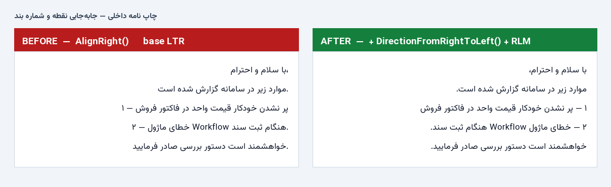

# جابه‌جایی نقطه و شمارهٔ بند در چاپ نامهٔ داخلی

**گزارش کاربر:** در «چاپ نامه داخلی شرکت ۱»، نقطهٔ پایان جمله به‌جای انتهای خط (سمت چپ) در **ابتدای** خط (سمت راست) چاپ می‌شد و شمارهٔ بندها («۱ —») به‌جای ابتدای خط (سمت راست) به **انتهای** خط (سمت چپ) می‌رفت.

---

## ۱) ریشهٔ مشکل

ایراد از قلم یا از قالب MRT نبود؛ از **جهت پایهٔ پاراگراف** (bidi base direction) بود.

در `InnerLetterPdfRenderer.cs` متن نامه فقط `AlignRight()` داشت:

```csharp
c.Item().Text(body).LineHeight(...).AlignRight();   // قبل
```

نکتهٔ کلیدی: **`AlignRight()` فقط «چینش» را راست می‌کند، نه «جهت» را.** این دو با هم فرق دارند:

| | چه چیزی را تعیین می‌کند | وضعیت قبل |
|---|---|---|
| `AlignRight()` | متن به کدام لبه بچسبد | ✅ تنظیم شده بود |
| `DirectionFromRightToLeft()` | ترتیب منطقی کاراکترها (الگوریتم Unicode Bidi) | ❌ تنظیم **نشده** بود |

در نبودِ جهتِ صریح، QuestPDF جهت پایه را از چیدمان صفحه می‌گرفت و صفحه در خط ۷۷ عمداً چپ‌به‌راست است:

```csharp
page.ContentFromLeftToRight();   // لازم است، وگرنه ترتیب فرزندانِ Row آینه می‌شود
```

نتیجه: هر خط متن با جهت پایهٔ **چپ‌به‌راست** چیده می‌شد. طبق الگوریتم Unicode Bidi، کاراکترهای «خنثی» (نقطه، ویرگول، دونقطه، خط تیره) و «اعداد» جهت خود را از جهت پایه می‌گیرند؛ پس:

- نقطهٔ انتهای جمله به **راست‌ترین** نقطه می‌رفت (ابتدای خط فارسی)،
- شمارهٔ ابتدای بند به **چپ‌ترین** نقطه می‌رفت (انتهای خط فارسی).

> `page.DefaultTextStyle(... .DirectionFromRightToLeft())` در خط ۷۸ هست، اما روی بلوک‌های متنی که خودشان جهت اعلام نمی‌کنند اثر لازم را نداشت. شاهدش همین فایل بود: بلوک «گیرنده/موضوع» (`LetterPrintTemplate.InfoBlock`) که **صراحتاً** `DirectionFromRightToLeft()` صدا می‌زند، همیشه درست چاپ می‌شد — فقط متن نامه و هامش خراب بود.

### چرا نامهٔ صادره این ایراد را نداشت؟

چون مسیر صادره (`RichLetterPdfRenderer`) از قبل هر تکهٔ متن را میان **RLM** محصور می‌کرد. کامنت فارسی همان فایل دقیقاً همین علامت را توضیح می‌دهد: «نتیجه: «،با سلام و احترام» و «.نمایند» دیگر جابه‌جا نمی‌شوند». نامهٔ **داخلی** تنها مسیر چاپی بود که این پوشش را نداشت.

---

## ۲) اصلاح انجام‌شده

هر سه لایه‌ای که مسیر صادره دارد، حالا در نامهٔ داخلی هم هست:

۱. **جهت صریح** روی خودِ بلوک متن (نه فقط ارث از صفحه):

```csharp
c.Item().Text(body).LineHeight(...).AlignRight().DirectionFromRightToLeft();   // بعد
```

۲. **محصور کردن هر خط میان RLM** (`U+200F`): علامت بی‌عرضِ «قویِ راست‌به‌چپ». RLM ابتدای خط جهت پایه را قطعی می‌کند و RLM انتها، نقطه/ویرگولِ پایانی را میان دو کاراکتر قوی RTL نگه می‌دارد.

۳. **جداسازی واژه‌های لاتین** با LRI/PDI (`U+2066`/`U+2069`) تا «Workflow» نقطهٔ کنارش را با خود نبرد — همان کاری که `<bdi>` در HTML می‌کند.

**نکتهٔ مهم:** متن نامه چندخطی است و در QuestPDF **هر خط یک پاراگراف مستقل** است که جهت پایهٔ خودش را جداگانه حساب می‌کند. پس محصور کردن کلِ رشته کافی نبود و پوشش **خط‌به‌خط** انجام می‌شود (`RtlPlainText`).

هر سه علامت **بی‌عرض** هستند: متن، شکستن خط، عرض ستون‌ها و تعداد صفحات هیچ تغییری نمی‌کند.

---

## ۳) نتیجه (قبل / بعد)



شبیه‌سازی با همان الگوریتم Unicode Bidi و همان قلم Vazirmatn مخزن:

| نمونه | قبل | بعد | انتظار |
|---|---|---|---|
| `۱ — پر نشدن خودکار…` | `۱` در لبهٔ **چپ** | `۱` در لبهٔ **راست** | راست ✅ |
| `…قیمت واحد پر نمی‌شود.` | `.` در لبهٔ **راست** | `.` در لبهٔ **چپ** | چپ ✅ |
| `گزارش Workflow آماده است.` | `.` در لبهٔ **راست** | `.` در لبهٔ **چپ** | چپ ✅ |

---

## ۴) فایل‌های تغییریافته

| فایل | تغییر |
|---|---|
| `Services/Office/InnerLetterPdfRenderer.cs` | متن نامه با `RtlPlainText` پوشانده شد؛ `DirectionFromRightToLeft()` به متن، هامش و سه برچسب چیدمان ساده اضافه شد |
| `Services/Office/LetterPrintTemplate.cs` | افزودن `RtlParagraph`، `RtlPlainText` و `IsolateLatinRuns` (محل مشترک هر دو مسیر چاپ) |
| `Services/Office/Outgoing/RichLetterPdfRenderer.cs` | الگوی تکراریِ «جزیرهٔ لاتین» حذف و به helper مشترک واگذار شد (رفتارش عیناً همان است) |
| `docs/prototypes/letter-print-preview/print-flow.test.cjs` | گاردهای جدید ضد بازگشتِ ایراد |
| `docs/prototypes/letter-print-preview/render-bidi-shot.py` | تولید تصویر قبل/بعد |

> دامنهٔ اصلاح: **همهٔ شرکت‌ها**، هر دو چیدمان (با سربرگ و بدون سربرگ) و هر دو اندازهٔ A4/A5. شرکت ۱ فقط جایی بود که کاربر به آن برخورد.

---

## ۵) آزمون

```bash
cd docs/prototypes/letter-print-preview
ln -sfn /tmp/ltxtest/node_modules node_modules && node print-flow.test.cjs; rm -f node_modules
```

گاردهای افزوده‌شده:

- متن نامه حتماً باید از `RtlPlainText(PlainText(data.Body))` عبور کند.
- هیچ بلوک متنی بدنه/برچسب بدون `DirectionFromRightToLeft()` نماند.
- تعداد `DirectionFromRightToLeft()` هرگز از تعداد `AlignRight()` کمتر نشود (همان ایرادِ «فقط چینش، بدون جهت»).
- helperهای RLM و LRI در `LetterPrintTemplate` باقی بمانند.

---

## ۶) نکتهٔ باقی‌مانده

روی این ماشین `dotnet` نصب نیست، پس تغییرات C# **کامپایل نشده‌اند**؛ منطق bidi با الگوریتم واقعی Unicode و قلم خود مخزن راستی‌آزمایی شده است. پیش از انتشار یک `dotnet build` و یک چاپ آزمایشی نامهٔ داخلی شرکت ۱ (یک‌بار با هامش و یک‌بار بدون) لازم است.
