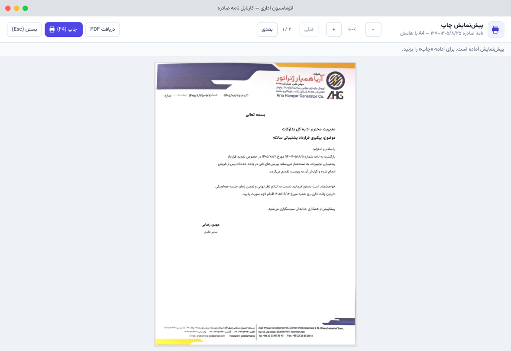

# چاپ نامه: پیش‌نمایش مشترک با فاکتور فروشگاهی، چاپ فقط وقتی کاربر بخواهد

دو گزارش پشت‌سرهم روی همین جریان:

| # | گزارش | وضعیت |
|---|---|---|
| ۱ | «با زدن دکمهٔ چاپ، پنجرهٔ چاپ مرورگر خودکار باز می‌شود و معطلی دارد» | انجام شد |
| ۲ | «این صفحهٔ پیش‌نمایش نامه زیاد جالب نیست؛ مثل پیش‌نمایش فاکتورهای ماژول فروشگاهی باشه» | انجام شد |

بخش **الف** پایین دربارهٔ گزارش اول است و بخش **ب** دربارهٔ گزارش دوم.

---

# الف) اول پیش‌نمایش، چاپ فقط وقتی کاربر بخواهد

گزارش: در ماژول اتوماسیون اداری، با زدن دکمهٔ چاپ، پیش‌نمایش باز می‌شد و **بلافاصله** — بدون
اینکه فرصت دیدن نامه باشد — پنجرهٔ چاپ مرورگر هم باز می‌شد؛ و لود آن سنگین بود و چند دقیقه
کاربر را معطل می‌کرد.

خواسته: فقط پیش‌نمایش نامه نشان داده شود؛ چاپ اگر کاربر خواست.

---

## علت اصلی (در کد)

`inventory/src/Inventory.Client/wwwroot/js/app-shell.js` → تابع `ltxPrintReady`.
این تابع وظیفه‌اش «نشان دادن PDF» بود، ولی در آخرین خط خودش چاپ را هم شروع می‌کرد:

```js
// قبل — خط پایانی ltxPrintReady
ltxSetPrintStatus(session, 'PDF آماده است؛ پنجرهٔ چاپ باز می‌شود…');
var printButton = …; if (printButton) printButton.hidden = false;
if (!ltxTriggerPrint(session)) throw new Error('مرورگر نتوانست پنجرهٔ چاپ را باز کند.');
```

یعنی دکمهٔ «چاپ PDF» ظاهر می‌شد ولی هیچ‌وقت به کار نمی‌آمد، چون همان لحظه `print()` صدا زده
می‌شد. سنگینی‌ای که کاربر حس می‌کرد مربوط به **رندر پنجرهٔ چاپ مرورگر** روی PDF سربرگ‌دار
است، نه ساخت PDF؛ و این هزینه به هر کسی که فقط می‌خواست نامه را ببیند هم تحمیل می‌شد.

### دو عارضهٔ پنهان همین خط

1. **سوختن بودجهٔ ۳۰ ثانیه‌ای تحویل.** فراخوانی `print()` در مرورگر تا بسته‌شدن پنجرهٔ چاپ
   برنمی‌گردد. چون داخل `ltxPrintReady` بود، `LetterPrintWorkflow` که این فراخوانی را با
   `HandoffTimeout = 30s` صدا می‌زد، برای کاربری که دیر تصمیم می‌گرفت تایم‌اوت می‌خورد و
   خطای بی‌مورد نشان می‌داد.
2. **بسته‌شدن پیش‌نمایش با «لغو».** مرورگر برای «چاپ شد» و «لغو شد» یک رویداد یکسان
   (`afterprint`) می‌فرستد و `ltxPrintAfterPrint` با آن کل پنجره را می‌بست؛ پس کاربری که در
   پنجرهٔ چاپ «لغو» می‌زد، پیش‌نمایشش را هم از دست می‌داد.

---

## رفتار جدید

`ltxPrintReady` فقط **نمایش می‌دهد** و تمام. پنجرهٔ چاپ مرورگر تنها از `ltxTriggerPrint` باز
می‌شود و `ltxTriggerPrint` تنها با کلیک کاربر روی دکمهٔ «چاپ» صدا زده می‌شود.

| موضوع | قبل | بعد |
|---|---|---|
| بعد از آماده‌شدن PDF | پنجرهٔ چاپ خودکار باز می‌شد | فقط پیش‌نمایش نامه |
| باز شدن پنجرهٔ چاپ | خودکار | فقط با کلیک روی «چاپ» |
| «لغو» در پنجرهٔ چاپ | پیش‌نمایش هم بسته می‌شد | پیش‌نمایش باز می‌ماند |
| چاپ دوباره | از اول PDF گرفته می‌شد | همان پیش‌نمایش، دکمهٔ «چاپ» |
| راه جایگزین | نداشت | دکمهٔ «دانلود PDF» |
| بستن پنجره توسط کاربر | Toast خطا | خطا نیست؛ ساکت تمام می‌شود |

نوار بالای پیش‌نمایش: **چاپ** · **دانلود PDF** · *(در خطا: تلاش مجدد / چاپ مستقیم صفحه)* · **بستن**

---

## اصلاحات

### ۱) `app-shell.js`

- **`ltxPrintReady`** دیگر `ltxTriggerPrint` را صدا نمی‌زند. به‌جایش وضعیت را روی
  «پیش‌نمایش نامه آماده است؛ برای چاپ، دکمهٔ «چاپ» را بزنید» می‌گذارد، دکمه‌های «چاپ» و
  «دانلود PDF» را نمایان می‌کند، پنجره را فوکوس می‌کند و برمی‌گردد.
- **`ltxTriggerPrint`** تنها نقطهٔ ورود به `print()` است؛ ضد دوبار-کلیک شده، دکمه را در حین
  چاپ غیرفعال می‌کند و پیش از فراخوانی مسدودکنندهٔ `print()` متن «در حال باز کردن پنجرهٔ چاپ
  مرورگر…» را نشان می‌دهد.
- **`ltxPrintAfterPrint`** دیگر پیش‌نمایش را نمی‌بندد (فقط «چاپ مستقیم صفحه» پاک‌سازی می‌کند)؛
  شنوندهٔ `afterprint` هم بدون `{ once: true }` ثبت می‌شود تا چاپ دوم هم شنیده شود و در
  `ltxPrintCleanup` حذف می‌گردد.
- **بستن**: `ltxRequestPrintClose` + `ltxWatchPrintWindow` — بستن با دکمه یا با ضربدر پنجره،
  هر دو منابع (objectURL، تایمرها، شنونده‌ها) را آزاد می‌کنند و شناسهٔ جلسه با
  `ltxPrintWasCancelled` به‌عنوان «انتخاب کاربر» علامت می‌خورد تا خطای الکی نشان داده نشود.
- **`ltxPrintDownload`**: دانلود همان PDF پیش‌نمایش، به‌عنوان راه فرار از پنجرهٔ چاپ کند.
- **رفع باگ جانبی**: دکمه‌های «تلاش مجدد» و «چاپ مستقیم» در حالت پنجرهٔ جدا بی‌اثر بودند.
  مسیرشان `postMessage` بود و شنونده با `event.source !== session.win` فیلتر می‌کرد؛ اما این
  توابع در realm پنجرهٔ اصلی اجرا می‌شوند، پس مرورگر پنجرهٔ اصلی را `source` می‌فرستد و پیام
  همیشه دور ریخته می‌شد. حالا `ltxResolvePrintAction` تصمیم را مستقیم در همان realm حل می‌کند
  (شنوندهٔ پیام برای سازگاری سر جایش مانده).

### ۲) `LetterPrintWorkflow.cs`

- نام مرحله‌ها در لاگ: `print-surface-ready → preview-surface-ready`،
  `browser-print-handoff → preview-shown`، `print-cancelled → preview-cancelled`،
  و مرحلهٔ تازهٔ `preview-closed-by-user`.
- `WasClosedByUserAsync(printId)`: اگر کاربر پنجره را بسته باشد، نه Toast قرمز، نه «تلاش مجدد».
- متن‌های کاربر از «چاپ» به «پیش‌نمایش» اصلاح شد (چون در این مرحله هنوز چاپی در کار نیست).
- بودجه‌های زمانی دست‌نخورده‌اند؛ فقط `HandoffTimeout` دیگر خرج انتظارِ تصمیم کاربر نمی‌شود.

### ۳) صفحه‌ها (فقط متن راهنما)
`LetterCartable.razor`، `OutgoingLetterCartable.razor`، `OutgoingLetterView.razor`،
`OutgoingDabirkhane.razor` — tooltip دکمه‌ها به «پیش‌نمایش … — چاپ از داخل پیش‌نمایش» و دکمهٔ
تأیید مودال دبیرخانه به «نمایش پیش‌نمایش» تغییر کرد.

> منطق دسترسی/مجوز چاپ (`OutgoingLetters.Dabirkhane`، وضعیت امضا و …) و مسیر ساخت PDF در سرور
> **هیچ تغییری نکرده‌اند**؛ این تغییر فقط سمت کلاینت و در لحظهٔ «نمایش در برابر چاپ» است.

---

# ب) ظاهر پیش‌نمایش: همان پیش‌نمایش فاکتور فروشگاهی

گزارش: «این صفحهٔ پیش‌نمایش نامه زیاد جالب نیست. مثل پیش‌نمایش فاکتورهای ماژول فروشگاهی باشه.»

## چرا درست است

پیش‌نمایش نامه یک پوستهٔ دست‌ساز و مخصوص خودش بود (`ltx-print-*`): یک پنجرهٔ بازشو با چند دکمهٔ
ساده، بدون بزرگ‌نمایی، بدون جابه‌جایی بین صفحه‌ها و با ظاهری متفاوت از بقیهٔ برنامه.

در حالی که همین برنامه از قبل یک پیش‌نمایش چاپ کامل دارد:
`inventory/src/Inventory.Client/wwwroot/js/shop-print-preview.js`. فاکتور فروش و خرید، حوالهٔ
خروج، گزارش‌های انبارگردانی، خزانه، کاردکس، کارت ویزیت و حتی «راهنمای اتوماسیون اداری» همگی از
آن استفاده می‌کنند — یعنی نامه‌ها تنها جایی بودند که از قافله جا مانده بودند.

نکتهٔ مهم: آن کامپوننت **از قبل هم «اول پیش‌نمایش» است** — دکمهٔ چاپش تا آماده‌شدن رندر
`disabled` است و تنها `print()` موجود در کل فایل داخل `printNow()` است که فقط با کلیک دکمه،
`F4` یا `Ctrl+P` اجرا می‌شود. پس این تغییر، دستاورد بخش الف را حفظ می‌کند.

## کاری که انجام شد

### ۱) `shop-print-preview.js` — مسیر «PDF تأخیری»

نامه یک تفاوت با فاکتور دارد: فاکتور HTML آماده در دست دارد، ولی PDF نامه را **سرور** می‌سازد و
چند ثانیه طول می‌کشد. کامپوننت مشترک فقط `openPdf(bytes)` داشت؛ یعنی باید تا آمادن بایت‌ها صبر
می‌کردیم و کاربر در این مدت هیچ بازخوردی نمی‌دید. پس یک چرخهٔ عمر تازه اضافه شد:

```js
const token = shopPrintPreview.beginPdf(title, message); // پوسته باز می‌شود؛ چاپ غیرفعال
shopPrintPreview.statusPdf(token, '…');                  // به‌روزرسانی نوار وضعیت
shopPrintPreview.resolvePdf(token, bytes, fileName);     // بایت‌ها رسیدند → رندر → چاپ فعال
shopPrintPreview.failPdf(token, 'پیام خطا');             // خطا داخل پیش‌نمایش + «تلاش مجدد»
await shopPrintPreview.waitForAction(token);             // 'retry' | 'close'
shopPrintPreview.isOpen(token); shopPrintPreview.cancelPdf(token);
```

جزئیات پیاده‌سازی:

- بدنهٔ `openPdf` به `loadPdfIntoSession` جدا شد تا هم `openPdf` (مسیر فعلی فروشگاه) و هم
  `resolvePdf` (مسیر نامه) از همان کد استفاده کنند. رفتار فاکتور تغییری نکرده.
- `openPdf` حالا پارامتر سوم `title` می‌گیرد. قبلاً عنوان سند روی `'فهرست کالا'` **ثابت** بود —
  برای نامه نادرست بود.
- دکمهٔ «تلاش مجدد» به نوار ابزار اضافه شد (به‌صورت پیش‌فرض `hidden`؛ فقط در خطا ظاهر می‌شود).
- حالت انتظار: به‌جای قاب سفید خالی، اسپینر + «در حال دریافت سند از سرور…».
- `close()` حالا نشست را از جدول توکن‌ها پاک می‌کند و اگر کسی روی `waitForAction` منتظر مانده
  باشد با `'close'` آزادش می‌کند — تا جریان #C هیچ‌وقت قفل نشود.

### ۲) `app-shell.js` — مسیردهی به‌جای بازنویسی

به‌جای دست‌زدن به همهٔ صفحه‌ها، همان API قدیمی `ltx*` سر جایش ماند و پشت آن مسیردهی شد:

```js
window.ltxPrintBegin = function (title) {
    const api = ltxShopPreview();
    if (api) { const token = api.beginPdf(title || 'نامه', 'در حال ساخت نسخهٔ چاپ نامه…');
               if (token) return 'shop:' + token; }
    return ltxLegacyPrintBegin();   // fallback
};
```

شناسهٔ برگشتی پیشوند `shop:` می‌گیرد و بقیهٔ توابع (`ltxPrintReady`، `ltxPrintStatus`،
`ltxPrintFail`، `ltxPrintWaitForAction`، `ltxPrintCancel`، `ltxPrintWasCancelled`) با دیدن آن
پیشوند به نشست مشترک مسیر می‌دهند. توابع قبلی با نام `ltxLegacy*` دست‌نخورده باقی ماندند و اگر
`shopPrintPreview` یا نمایشگر PDF در دسترس نباشد (نسخهٔ کش‌شدهٔ قدیمی، خرابی `filePreview`)
همان پوستهٔ قبلی کار می‌کند. یعنی این تغییر **بازگشت‌پذیر** است و چاپ نامه بی‌جواب نمی‌ماند.

تنها قابلیتی که معادل ندارد «چاپ مستقیم صفحه» است؛ در پیش‌نمایش مشترک «دریافت PDF» جای بهتری
برای همان نیاز است.

### ۳) `LetterPrintWorkflow.cs` و چهار صفحهٔ نامه — عنوان سند

`PrintPdfAsync` پارامتر اختیاری `title` گرفت و آن را به `ltxPrintBegin` می‌دهد؛ اگر داده نشود
نام فایل استفاده می‌شود. صفحه‌ها عنوان خوانا می‌فرستند، مثلاً:

```csharp
var title = $"نامهٔ صادره {number} — {size} {(withMargin ? "با هامش" : "بدون هامش")}";
await PrintWorkflow.PrintPdfAsync(ct => OutgoingSvc.GetPrintPdfAsync(...), name, title);
```

### ۴) `index.html`
شمارهٔ نسخهٔ `shop-print-preview.css`، `app-shell.js` و `shop-print-preview.js` یک واحد بالا رفت
تا کش مرورگر کاربرها نسخهٔ قدیمی را نگه ندارد.

## نتیجه

| موضوع | قبل | بعد |
|---|---|---|
| ظاهر | پنجرهٔ بازشوِ مخصوص نامه | همان پیش‌نمایش فاکتور فروشگاهی |
| بزرگ‌نمایی | نداشت | `−` / `۱۰۰٪` / `+` |
| چند صفحه‌ای | نداشت | «قبلی / ۱ از ۲ / بعدی» |
| کلید میان‌بر | نداشت | `F4` چاپ، `Esc` بستن |
| هنگام ساخت سند | پنجرهٔ خالی | اسپینر + «در حال دریافت سند از سرور…» |
| خطای سرور | Toast بیرون پنجره | داخل خود پیش‌نمایش + «تلاش مجدد» |
| عنوان سند | نداشت | «نامهٔ صادره ۱۴۰۵/۸/۲۵–۱۲۷ — A4 با هامش» |
| مسدود شدن popup | مشکل‌ساز بود | موضوعیت ندارد (لایهٔ داخل صفحه) |



تصویرهای حالت انتظار و حالت خطا در
`docs/prototypes/letter-print-preview/README.md` هستند.

---

## آزمایش

### نمونهٔ زنده (بدون نیاز به بیلد .NET)
```bash
# از ریشهٔ مخزن
python3 -m http.server 8090 --bind 0.0.0.0
# http://localhost:8090/docs/prototypes/letter-print-preview/index.html
```
این صفحه **خودِ فایل‌های تولیدی** را لود می‌کند (نه کپی): `app-shell.js`، `file-preview.js` و
`shop-print-preview.js` با همان ترتیب `index.html`. همان ترتیب فراخوانی `LetterPrintWorkflow` را
اجرا می‌کند و `window.print` را هوک می‌کند تا هر چاپ خودکاری در گزارش رویدادها دیده شود.
دو گزینهٔ آزمایش دارد: «رندر کند سرور (۱۰ ثانیه)» و «خطای سرور».

### تست خودکار
```bash
npm install jsdom
node docs/prototypes/letter-print-preview/print-flow.test.cjs
# ALL PRINT-FLOW CHECKS PASSED
```
پوشش:
- **گاردِ ایستا** — نه مسیر بارگذاری PDF در کامپوننت مشترک و نه `ltxLegacyPrintReady` اجازهٔ
  `print()` ندارند؛ کل `shop-print-preview.js` دقیقاً **یک** `print()` دارد و آن هم داخل
  `printNow` (هندلر دکمه) است.
- **پیش‌نمایش مشترک** — نامه واقعاً به `shop:` مسیر می‌خورد؛ پوسته با عنوان درست و چاپِ غیرفعال
  باز می‌شود؛ وضعیت به‌روز می‌شود؛ با رسیدن بایت‌ها چاپ فعال و «دریافت PDF» ظاهر می‌شود **بدون**
  باز شدن پنجرهٔ چاپ؛ کلیک کاربر دقیقاً یک بار چاپ می‌کند؛ پیش‌نمایش بعد از چاپ باز می‌ماند.
- **مسیر خطا** — خطا داخل پیش‌نمایش می‌نشیند، «تلاش مجدد» به جریان منتظرِ #C می‌رسد، و بستنِ
  پنجره آن انتظار را قفل نمی‌کند.
- **پوستهٔ قدیمی** — وقتی `shopPrintPreview` نیست، همان رفتار «اول پیش‌نمایش» برقرار است.

### تست دستی
1. کارتابل نامهٔ صادره → نامه → چاپ → «A4 — با هامش».
2. پیش‌نمایش **بلافاصله** باز می‌شود؛ خالی، با اسپینر و «در حال دریافت سند از سرور…»، و دکمهٔ
   «چاپ (F4)» غیرفعال است. عنوان سند بالای پنجره درست نوشته شده باشد.
3. نامه که رندر شد داخل همان قاب دیده می‌شود، «چاپ (F4)» فعال و «دریافت PDF» ظاهر می‌شود؛
   **هیچ پنجرهٔ چاپی باز نشده است**.
4. بزرگ‌نمایی و «قبلی/بعدی» را امتحان کنید (نامهٔ دو صفحه‌ای).
5. «چاپ (F4)» → پنجرهٔ چاپ مرورگر. در آن «لغو» → پیش‌نمایش هنوز باز است و می‌شود دوباره زد.
6. `Esc` یا «بستن» → بدون پیام خطا بسته می‌شود.
7. همین مراحل برای نامهٔ داخلی، نمایش نامهٔ صادره و مودال دبیرخانه.
8. مطمئن شوید فاکتور فروشگاهی و گزارش‌ها هم مثل قبل کار می‌کنند (کد مشترک تغییر کرده).

> وضعیت بیلد: تغییرات کامپایل نشده‌اند (dotnet در این محیط نصب نیست) — `dotnet build` لازم است.
> سمت #C فقط یک پارامتر اختیاری (`string? title = null`) به `PrintPdfAsync` اضافه شده و چهار
> صفحه آن را پر می‌کنند؛ امضای قبلی هم سازگار مانده. سمت JS با `node --check` و تست jsdom
> بررسی شده است.
