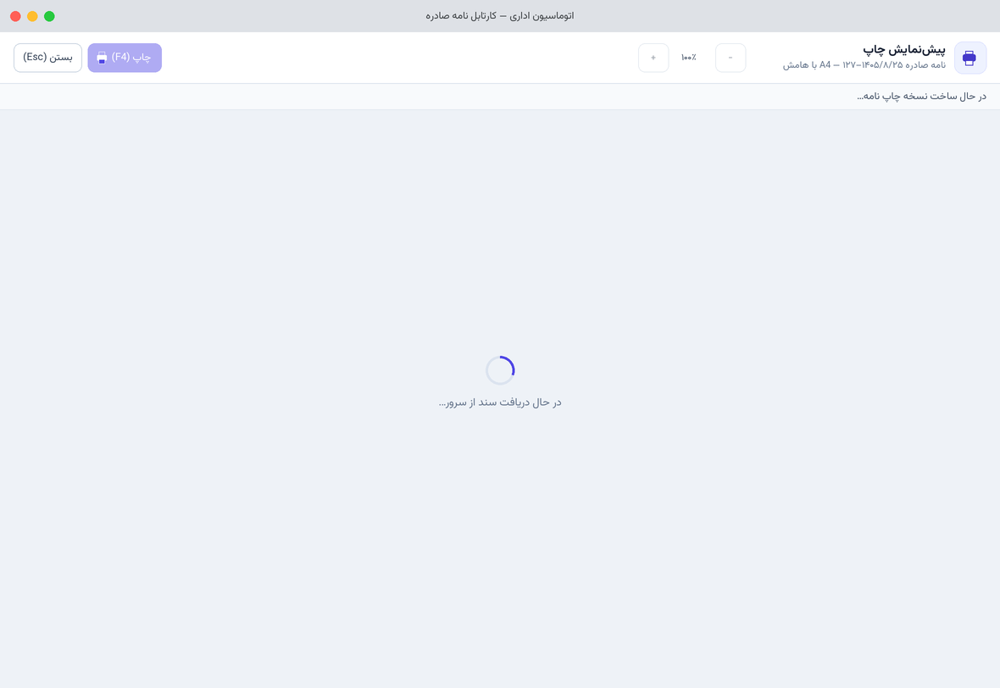
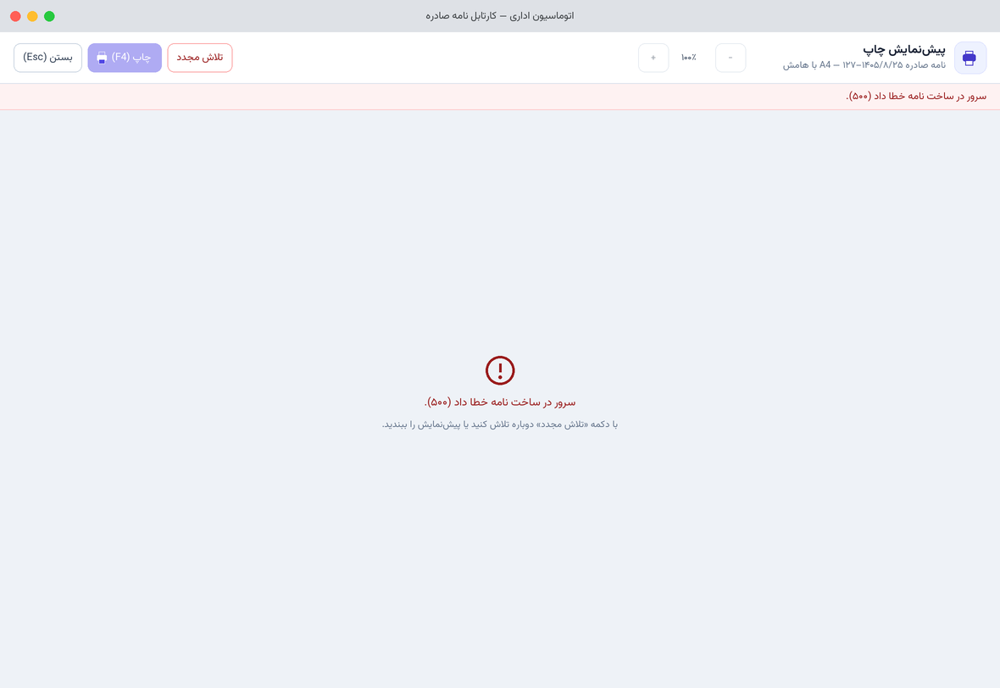

# چاپ نامه: پیش‌نمایش مشترک با فاکتور فروشگاهی، چاپ فقط با درخواست کاربر

این پوشه دو تغییر پشت‌سرهم روی چاپ نامهٔ اتوماسیون اداری را مستند می‌کند:

1. **چاپ خودکار حذف شد** — اول پیش‌نمایش، چاپ فقط با کلیک کاربر.
2. **ظاهر پیش‌نمایش یکسان شد** — نامه‌ها هم از همان پیش‌نمایشی استفاده می‌کنند که فاکتور
   فروشگاهی و گزارش‌ها استفاده می‌کنند.

---

## ۱) مسئلهٔ اول: چاپ خودکار

زدن دکمهٔ چاپ نامه پنجرهٔ پیش‌نمایش را باز می‌کرد و **بلافاصله** پنجرهٔ چاپ مرورگر را هم باز
می‌کرد. رندر آن پنجره برای نامهٔ روی سربرگ سنگین است و کاربر معطل می‌ماند — حتی وقتی فقط
می‌خواست نامه را ببیند.

ریشهٔ کد: در `app-shell.js` تابع `ltxPrintReady` درست بعد از بارگذاری PDF خودش
`ltxTriggerPrint(session)` را صدا می‌زد:

```js
// قبل
ltxSetPrintStatus(session, 'PDF آماده است؛ پنجرهٔ چاپ باز می‌شود…');
if (!ltxTriggerPrint(session)) throw new Error('مرورگر نتوانست پنجرهٔ چاپ را باز کند.');
```

حالا «آماده‌شدن» فقط **نمایش** است. پنجرهٔ چاپ مرورگر تنها با کلیک روی «چاپ» (یا `F4` /
`Ctrl+P`) باز می‌شود.

دو اصلاح جانبی که از دل همین تغییر درآمدند:

1. **`print()` مرورگر مسدودکننده است** و تا بسته‌شدن پنجرهٔ چاپ برنمی‌گردد. چون این فراخوانی
   داخل `ltxPrintReady` بود، بودجهٔ ۳۰ ثانیه‌ای «تحویل به مرورگر» در `LetterPrintWorkflow` را
   هم می‌سوزاند و برای کاربری که دیر تصمیم می‌گرفت خطای بی‌مورد می‌ساخت.
2. **دکمه‌های «تلاش مجدد» و «چاپ مستقیم» در پنجرهٔ جدا بی‌اثر بودند.** مسیرشان `postMessage`
   بود و شنونده با `event.source !== session.win` فیلتر می‌کرد؛ چون این توابع در realm پنجرهٔ
   اصلی اجرا می‌شوند، پیام همیشه دور ریخته می‌شد.

---

## ۲) مسئلهٔ دوم: ظاهر پیش‌نمایش

پیش‌نمایش نامه یک پنجرهٔ بازشوِ دست‌سازِ مخصوص خودش بود (`ltx-print-*`): بدون بزرگ‌نمایی،
بدون جابه‌جایی بین صفحه‌ها و با ظاهری متفاوت از بقیهٔ برنامه. در حالی که همین برنامه از قبل
یک پیش‌نمایش چاپ خوب دارد — `wwwroot/js/shop-print-preview.js` — که فاکتور فروشگاهی،
گزارش‌های انبار، خزانه، کاردکس و حتی «راهنمای اتوماسیون اداری» از آن استفاده می‌کنند.

حالا نامه‌ها هم به همان مسیر می‌روند. `ltxPrintBegin` اگر `shopPrintPreview` در دسترس باشد
یک نشست از همان کامپوننت باز می‌کند و شناسه‌ای با پیشوند `shop:` برمی‌گرداند؛ بقیهٔ توابع
(`ltxPrintReady`، `ltxPrintStatus`، `ltxPrintFail`، …) با دیدن آن پیشوند به همان نشست
مسیردهی می‌کنند. اگر کامپوننت یا نمایشگر PDF نبود، همان پوستهٔ قدیمی کار می‌کند.

| موضوع | قبل | بعد |
|---|---|---|
| ظاهر | پنجرهٔ بازشوِ مخصوص نامه | همان پیش‌نمایش فاکتور فروشگاهی |
| بعد از آماده‌شدن PDF | پنجرهٔ چاپ خودکار باز می‌شد | فقط پیش‌نمایش؛ «چاپ (F4)» فعال می‌شود |
| بزرگ‌نمایی | نداشت | `−` / `۱۰۰٪` / `+` |
| چند صفحه‌ای | نداشت | «قبلی / ۱ از ۲ / بعدی» |
| کلید میان‌بر | نداشت | `F4` چاپ، `Esc` بستن |
| هنگام ساخت سند | پنجرهٔ خالی | اسپینر + «در حال دریافت سند از سرور…» |
| خطای سرور | Toast بیرون پنجره | داخل خود پیش‌نمایش + «تلاش مجدد» |
| جایگزین چاپ | «دانلود PDF» | «دریافت PDF» |
| بستن پنجره توسط کاربر | Toast خطا می‌داد | خطا نیست؛ ساکت تمام می‌شود |

### چیزهایی که به کامپوننت مشترک اضافه شد

نامه‌ها یک تفاوت با فاکتور دارند: فاکتور HTML آماده دارد، ولی نامه را **سرور** رندر می‌کند و
چند ثانیه طول می‌کشد. پس به `shop-print-preview.js` یک مسیر «اول پوسته، بعد محتوا» اضافه شد:

```js
const token = shopPrintPreview.beginPdf(title, message); // پوسته باز می‌شود، چاپ غیرفعال
shopPrintPreview.statusPdf(token, '…');                  // به‌روزرسانی نوار وضعیت
shopPrintPreview.resolvePdf(token, bytes, fileName);     // بایت‌ها رسیدند → رندر → چاپ فعال
shopPrintPreview.failPdf(token, 'پیام خطا');             // خطا داخل پیش‌نمایش + «تلاش مجدد»
await shopPrintPreview.waitForAction(token);             // 'retry' | 'close'
```

`openPdf` هم حالا پارامتر سوم `title` می‌گیرد (قبلاً عنوان سند روی `'فهرست کالا'` ثابت بود).

---

## فایل‌های تغییر کرده
- `wwwroot/js/shop-print-preview.js` — مسیر PDF تأخیری (`beginPdf`/`statusPdf`/`resolvePdf`/
  `failPdf`/`waitForAction`/`isOpen`/`cancelPdf`)، دکمهٔ «تلاش مجدد»، عنوان سند پارامتری
- `wwwroot/css/shop-print-preview.css` — حالت انتظار (اسپینر) و ظاهر دکمهٔ «تلاش مجدد»
- `wwwroot/js/app-shell.js` — حذف چاپ خودکار + مسیردهی `ltx*` به پیش‌نمایش مشترک
- `Services/LetterPrintWorkflow.cs` — عنوان سند، نام مرحله‌ها و تشخیص «کاربر خودش بست»
- چهار صفحهٔ نامه (کارتابل داخلی، کارتابل صادره، نمایش صادره، دبیرخانه) — عنوان سند + راهنمای دکمه

شرح کامل فارسی: `TotallCollectionSoftware/LETTER-PRINT-PREVIEW-FIRST-FA.md`

## تصویر پیش‌نمایش

**۱. سند در حال ساخت است** — چاپ غیرفعال، اسپینر، نوار وضعیت:



**۲. نامه رندر شد** — «چاپ (F4)» فعال و «دریافت PDF» ظاهر می‌شود، ولی هنوز **هیچ پنجرهٔ چاپی
باز نشده است**. وضعیت: «پیش‌نمایش آماده است. برای ادامه «چاپ» را بزنید.»


**۳. خطای سرور** — به‌جای Toast بیرونی، خطا داخل خود پیش‌نمایش با دکمهٔ «تلاش مجدد»:



این تصویرها با `render-preview-shot.py` ساخته می‌شوند. اسکریپت متن دکمه‌ها، متن‌های وضعیت و
رنگ‌ها را **از خودِ `shop-print-preview.js` و `shop-print-preview.css` می‌خواند** (و اگر مسیر
بارگذاری PDF دوباره `print()` صدا بزند با assert می‌شکند)، پس تصویر نمی‌تواند از کد واقعی جدا
بیفتد:

```bash
python3 -m venv .venv && .venv/bin/pip install pillow arabic-reshaper python-bidi pypdfium2
.venv/bin/python docs/prototypes/letter-print-preview/render-preview-shot.py out.png waiting
.venv/bin/python docs/prototypes/letter-print-preview/render-preview-shot.py out.png ready
.venv/bin/python docs/prototypes/letter-print-preview/render-preview-shot.py out.png error
```

> متن نامه روی سربرگ واقعی شرکت (`aria_company1005_letterhead.pdf`) نمونه است؛ مخزن نامهٔ
> رندرشدهٔ آماده ندارد و ساختنش به مسیر QuestPDF سمت سرور نیاز دارد.

## اجرای نمونهٔ زنده
```bash
# از ریشهٔ مخزن
python3 -m http.server 8090 --bind 0.0.0.0
# http://localhost:8090/docs/prototypes/letter-print-preview/index.html
```
این صفحه **خودِ فایل‌های تولیدی** را لود می‌کند (نه یک کپی): `app-shell.js`،
`file-preview.js` و `shop-print-preview.js` با همان ترتیب `index.html`. ترتیب فراخوانی
`LetterPrintWorkflow` را اجرا می‌کند و `window.print` را هوک می‌کند تا اگر چاپ خودکاری رخ دهد
در گزارش رویدادها دیده شود. دو گزینه برای آزمایش هست: «رندر کند سرور (۱۰ ثانیه)» برای دیدن
حالت انتظار، و «خطای سرور» برای دیدن «تلاش مجدد».

## تست خودکار
```bash
npm install jsdom           # تنها وابستگی
node docs/prototypes/letter-print-preview/print-flow.test.cjs
# ALL PRINT-FLOW CHECKS PASSED
```
پوشش تست:
- **ایستا** — نه مسیر بارگذاری PDF در کامپوننت مشترک و نه `ltxLegacyPrintReady` اجازهٔ
  `print()` ندارند؛ کل کامپوننت مشترک دقیقاً **یک** `print()` دارد و آن هم داخل `printNow`
  (هندلر دکمه) است.
- **پیش‌نمایش مشترک** — نامه واقعاً به `shop:` مسیردهی می‌شود؛ پوسته با عنوان درست و چاپِ
  غیرفعال باز می‌شود؛ وضعیت به‌روزرسانی می‌شود؛ با رسیدن بایت‌ها چاپ فعال و «دریافت PDF»
  ظاهر می‌شود **بدون** باز شدن پنجرهٔ چاپ؛ کلیک کاربر دقیقاً یک بار چاپ می‌کند؛ پیش‌نمایش بعد
  از چاپ باز می‌ماند؛ بستن «کاربر خودش بست» گزارش می‌شود.
- **مسیر خطا** — پیام خطا با استایل خطا داخل پیش‌نمایش می‌نشیند، «تلاش مجدد» ظاهر و به جریان
  منتظرِ #C می‌رسد، و بستنِ پنجره آن انتظار را قفل نمی‌کند.
- **پوستهٔ قدیمی** — وقتی `shopPrintPreview` نیست، همان رفتار «اول پیش‌نمایش» برقرار است.

## تست دستی
1. کارتابل نامهٔ صادره → نامه را باز کنید → چاپ → «A4 — با هامش».
2. پیش‌نمایش **بلافاصله** باز می‌شود (خالی، با پیام «در حال دریافت سند از سرور…») و دکمهٔ
   «چاپ (F4)» غیرفعال است.
3. نامه که رندر شد داخل همان قاب دیده می‌شود، «چاپ (F4)» فعال و «دریافت PDF» ظاهر می‌شود؛
   **هیچ پنجرهٔ چاپی باز نشده است**.
4. بزرگ‌نمایی و «قبلی/بعدی» را امتحان کنید؛ برای نامهٔ دو صفحه‌ای هر دو صفحه دیده می‌شود.
5. «چاپ (F4)» → پنجرهٔ چاپ مرورگر باز می‌شود. در آن «لغو» بزنید → پیش‌نمایش هنوز باز است.
6. `Esc` یا «بستن» → پیش‌نمایش بسته می‌شود، بدون پیام خطا.
