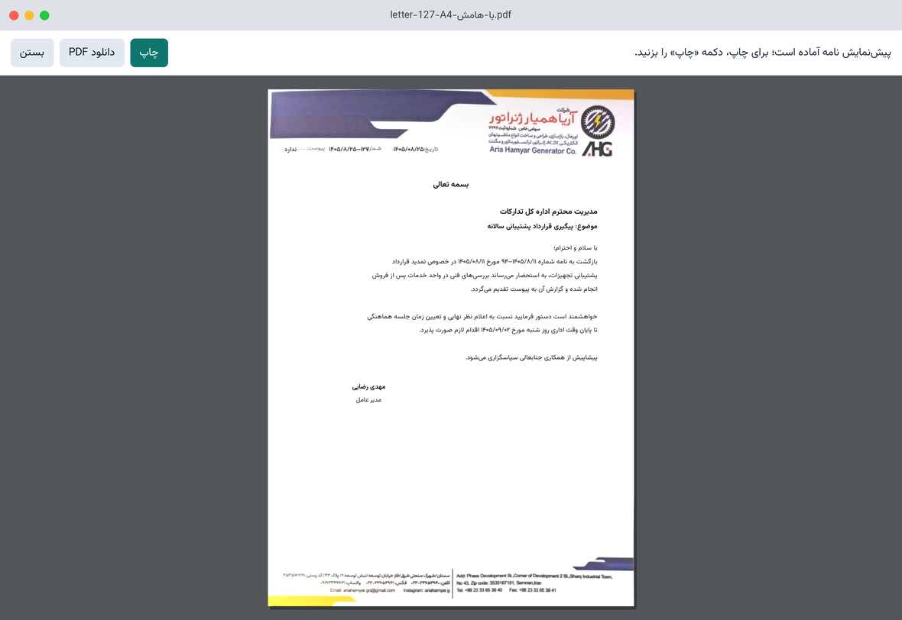
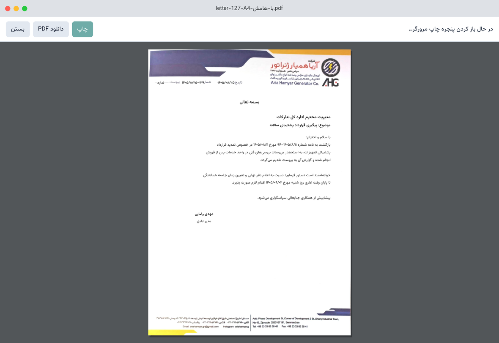

# چاپ نامه: «اول پیش‌نمایش، چاپ فقط با درخواست کاربر»

## مسئله
در ماژول اتوماسیون اداری، زدن دکمهٔ چاپ نامه پنجرهٔ پیش‌نمایش را باز می‌کرد و **بلافاصله**
(بدون اینکه کاربر فرصت دیدن نامه را داشته باشد) پنجرهٔ چاپ مرورگر را هم باز می‌کرد. رندر آن
پنجره برای نامهٔ روی سربرگ سنگین است و کاربر چند دقیقه معطل می‌ماند — حتی وقتی فقط می‌خواست
نامه را ببیند.

ریشهٔ کد: در `inventory/src/Inventory.Client/wwwroot/js/app-shell.js` تابع `ltxPrintReady`
درست بعد از بارگذاری PDF در iframe، خودش `ltxTriggerPrint(session)` را صدا می‌زد و اگر موفق
نمی‌شد حتی خطا پرتاب می‌کرد:

```js
// قبل
ltxSetPrintStatus(session, 'PDF آماده است؛ پنجرهٔ چاپ باز می‌شود…');
if (!ltxTriggerPrint(session)) throw new Error('مرورگر نتوانست پنجرهٔ چاپ را باز کند.');
```

## رفتار جدید
`ltxPrintReady` فقط **نمایش** می‌دهد: PDF در پیش‌نمایش بارگذاری می‌شود، وضعیت به
«پیش‌نمایش نامه آماده است؛ برای چاپ، دکمهٔ «چاپ» را بزنید» تغییر می‌کند و دکمه‌های «چاپ» و
«دانلود PDF» ظاهر می‌شوند. پنجرهٔ چاپ مرورگر **تنها** از `ltxTriggerPrint` باز می‌شود و
`ltxTriggerPrint` فقط با کلیک کاربر صدا زده می‌شود.

| موضوع | قبل | بعد |
|---|---|---|
| بعد از آماده‌شدن PDF | پنجرهٔ چاپ خودکار باز می‌شد | فقط پیش‌نمایش |
| باز شدن پنجرهٔ چاپ | خودکار | با کلیک روی «چاپ» |
| لغو در پنجرهٔ چاپ | پیش‌نمایش هم بسته می‌شد | پیش‌نمایش باز می‌ماند |
| چاپ دوباره | باید از اول PDF گرفته می‌شد | همان پیش‌نمایش، دکمهٔ «چاپ» |
| جایگزین چاپ | نداشت | دکمهٔ «دانلود PDF» |
| بستن پنجره توسط کاربر | Toast خطا می‌داد | خطا نیست؛ ساکت تمام می‌شود |

دو اصلاح جانبی که از دل همین تغییر درآمدند:

1. **`print()` مرورگر مسدودکننده است** و تا بسته‌شدن پنجرهٔ چاپ برنمی‌گردد. چون این فراخوانی
   داخل `ltxPrintReady` بود، بودجهٔ ۳۰ ثانیه‌ای «تحویل به مرورگر» در `LetterPrintWorkflow` را
   هم می‌سوزاند و برای کاربری که دیر تصمیم می‌گرفت خطای بی‌مورد می‌ساخت. حالا آن بودجه فقط
   خرج بارگذاری PDF می‌شود.
2. **دکمه‌های «تلاش مجدد» و «چاپ مستقیم» در پنجرهٔ جدا بی‌اثر بودند.** مسیرشان
   `postMessage` بود و شنونده با `event.source !== session.win` فیلتر می‌کرد؛ چون این توابع در
   realm پنجرهٔ اصلی اجرا می‌شوند، مرورگر پنجرهٔ اصلی را به‌عنوان `source` می‌فرستد و پیام همیشه
   دور ریخته می‌شد. حالا تصمیم مستقیم در همان realm حل می‌شود.

## فایل‌های تغییر کرده
- `TotallCollectionSoftware/inventory/src/Inventory.Client/wwwroot/js/app-shell.js` — کل جریان پیش‌نمایش/چاپ
- `TotallCollectionSoftware/inventory/src/Inventory.Client/Services/LetterPrintWorkflow.cs` — نام
  مرحله‌ها، متن‌ها و تشخیص «کاربر خودش بست»
- چهار صفحهٔ نامه (کارتابل داخلی، کارتابل صادره، نمایش صادره، دبیرخانه) — فقط متن راهنمای دکمه

شرح کامل فارسی: `TotallCollectionSoftware/LETTER-PRINT-PREVIEW-FIRST-FA.md`

## تصویر پنجرهٔ پیش‌نمایش



وضعیت نوار بالا: «پیش‌نمایش نامه آماده است؛ برای چاپ، دکمهٔ «چاپ» را بزنید.» —
هیچ پنجرهٔ چاپی باز نشده است.



فقط بعد از کلیک روی «چاپ»: دکمه تا پایان کار غیرفعال می‌شود و وضعیت به
«در حال باز کردن پنجرهٔ چاپ مرورگر…» می‌رود؛ همین‌جا پنجرهٔ چاپ سیستم باز می‌شود.

این دو تصویر با `render-preview-shot.py` ساخته می‌شوند. اسکریپت متن دکمه‌ها، متن‌های وضعیت و
اینکه کدام دکمه‌ها نمایان‌اند را **از خودِ `app-shell.js` می‌خواند** (و اگر `ltxPrintReady`
دوباره `print()` صدا بزند با assert می‌شکند)، پس تصویر نمی‌تواند از کد واقعی جدا بیفتد:

```bash
python3 -m venv .venv && .venv/bin/pip install pillow arabic-reshaper python-bidi pypdfium2
.venv/bin/python docs/prototypes/letter-print-preview/render-preview-shot.py out.png ready
.venv/bin/python docs/prototypes/letter-print-preview/render-preview-shot.py out2.png printing
```

> متن نامه روی سربرگ واقعی شرکت (`aria_company1005_letterhead.pdf`) نمونه است؛ مخزن نامهٔ
> رندرشدهٔ آماده ندارد و ساختنش به مسیر QuestPDF سمت سرور نیاز دارد.

## اجرای نمونهٔ زنده
```bash
# از ریشهٔ مخزن
python3 -m http.server 8090 --bind 0.0.0.0
# http://localhost:8090/docs/prototypes/letter-print-preview/index.html
```
این صفحه **خودِ `app-shell.js` تولیدی** را لود می‌کند (نه یک کپی) و همان ترتیب فراخوانی
`LetterPrintWorkflow` را اجرا می‌کند؛ ضمناً `window.print` را هوک می‌کند تا اگر چاپ خودکاری
رخ دهد در گزارش رویدادها دیده شود. گزینهٔ «شبیه‌سازی رندر کند سرور» متن وضعیت را هم نشان می‌دهد.

## تست خودکار
```bash
npm install jsdom           # تنها وابستگی
node docs/prototypes/letter-print-preview/print-flow.test.cjs
# ALL PRINT-FLOW CHECKS PASSED
```
پوشش تست: پیش‌نمایش بدون چاپ خودکار، چاپ با کلیک، باز ماندن پیش‌نمایش بعد از `afterprint`،
چاپ دوم، بستن و آزادسازی منابع، حالت popup-blocked (لایهٔ داخل صفحه)، مسیر خطا با
«تلاش مجدد»، و رسیدن «بستن» به جریان منتظرِ #C.

## تست دستی
1. کارتابل نامهٔ صادره → نامه را باز کنید → چاپ → «A4 — با هامش».
2. پیش‌نمایش باز می‌شود و **همان‌جا می‌ماند**؛ هیچ پنجرهٔ چاپی باز نمی‌شود.
3. دکمهٔ «چاپ» در نوار بالای پیش‌نمایش → پنجرهٔ چاپ مرورگر باز می‌شود.
4. در پنجرهٔ چاپ «لغو» بزنید → پیش‌نمایش هنوز باز است و می‌توان دوباره «چاپ» زد.
5. «بستن» → پیش‌نمایش بسته می‌شود، بدون پیام خطا.
